<picture><source media="(prefers-color-scheme: dark)" srcset="assets/hero-dark.svg"></picture>

<picture><source media="(prefers-color-scheme: dark)" srcset="assets/stack-dark.svg"></picture>

<a href="https://github.com/kittenello/Donutgram"><picture><source media="(prefers-color-scheme: dark)" srcset="assets/project-donutgram-dark.svg"></picture></a>&nbsp;<a href="https://github.com/kittenello/Amethyst"><picture><source media="(prefers-color-scheme: dark)" srcset="assets/project-amethyst-dark.svg"></picture></a>

<a href="https://github.com/kittenello/Discord-Crasher"><picture><source media="(prefers-color-scheme: dark)" srcset="assets/project-discord-crasher-dark.svg"></picture></a>&nbsp;<a href="https://github.com/kittenello/CSV-Tools"><picture><source media="(prefers-color-scheme: dark)" srcset="assets/project-csv-tools-dark.svg"></picture></a>

<picture><source media="(prefers-color-scheme: dark)" srcset="assets/stats-dark.svg"></picture>

<picture><source media="(prefers-color-scheme: dark)" srcset="assets/streak-dark.svg"></picture>

<picture><source media="(prefers-color-scheme: dark)" srcset="assets/wave-dark.svg"></picture>

<a href="https://t.me/donutgram"><picture><source media="(prefers-color-scheme: dark)" srcset="assets/button-1-dark.svg"></picture></a>&nbsp;&nbsp;<a href="https://github.com/kittenello?tab=repositories"><picture><source media="(prefers-color-scheme: dark)" srcset="assets/button-2-dark.svg"></picture></a>

